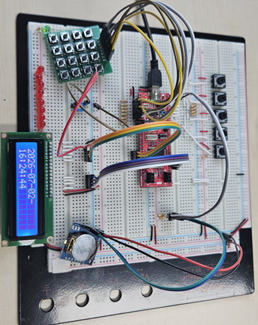
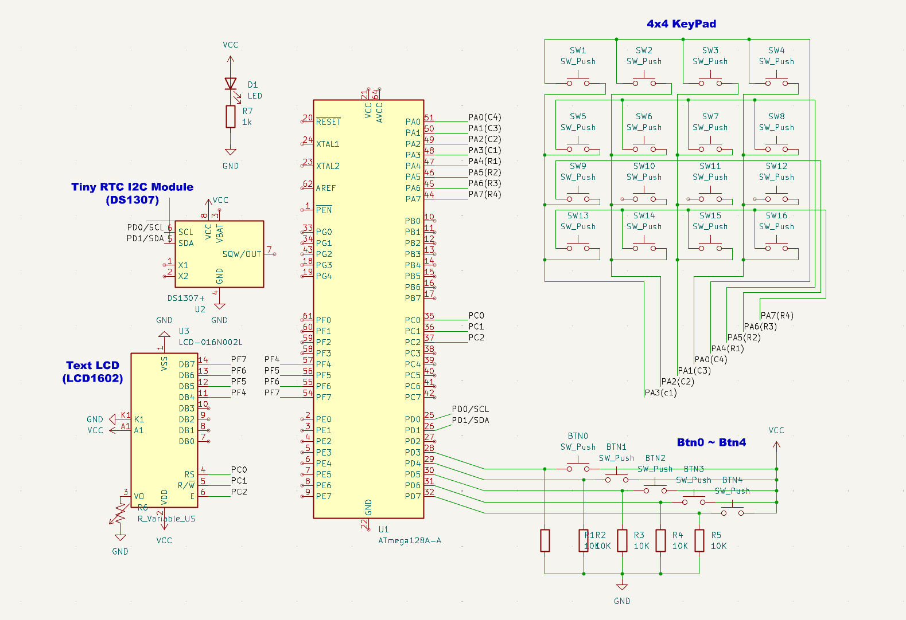
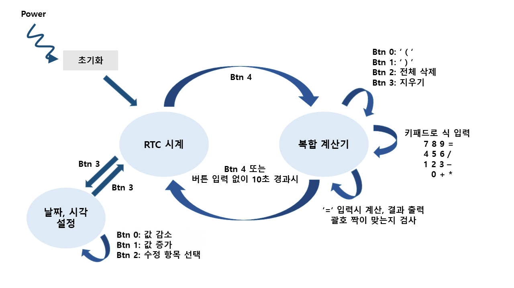

# ATmega128A LCD·RTC 계산기

ATmega128A에 LCD1602, DS1307 RTC 모듈, 4×4 키패드를 연결해 만든 시계·계산기 프로젝트입니다. 버튼으로 두 모드를 전환하고, 시계 모드에서는 날짜와 시간을 표시·수정하며 계산기 모드에서는 입력한 수식을 계산합니다.

이 프로젝트에서는 LCD1602와 DS1307의 데이터시트 및 타이밍 차트를 읽고, GPIO와 TWI(I²C) 레지스터를 이용해 주변장치 제어 코드를 구현했습니다. 계산기에는 원형 큐와 스택을 사용했습니다.

**진행 기간:** 2026.07.01 ~ 2026.07.03



## 개발 환경 및 하드웨어 구성

| 항목 | 구성 |
| --- | --- |
| 개발 환경 | Microchip Studio, C |
| Target MCU | ATmega128A, 16 MHz 설정 |
| RTC | DS1307 I²C 모듈 |
| 화면 | LCD1602 문자 LCD, 4비트 인터페이스 |
| 입력 | 4×4 매트릭스 키패드, 택트 스위치 5개 |
| 주변장치 | GPIO, Timer0, TWI(I²C), UART0 |
| 자료구조 | 원형 큐, 스택 |



## 주요 기능

- **시계 모드:** DS1307에서 날짜와 시간을 읽어 LCD에 표시합니다. BTN3으로 시간 설정을 시작하거나 저장합니다. 설정 중 BTN2는 항목 선택, BTN1은 값 증가, BTN0은 값 감소입니다.
- **계산기 모드:** 키패드로 수식을 입력하고 `=`를 누르면 중위 수식을 후위 표기로 변환해 계산합니다. BTN0/BTN1은 괄호, BTN2는 전체 삭제, BTN3은 마지막 문자 삭제입니다.
- **모드 전환:** BTN4로 시계와 계산기를 전환합니다. 계산기에서 10초간 입력이 없으면 시계 화면으로 돌아갑니다.

### 키패드 문자 배치

| | | | |
| --- | --- | --- | --- |
| 7 | 8 | 9 | = |
| 4 | 5 | 6 | / |
| 1 | 2 | 3 | - |
| 백스페이스 | 0 | + | `*` |

왼쪽 아래 키는 공백 문자로 입력되며, 계산기에서는 직전 문자를 지우는 데 사용합니다.

## 동작 구조

```text
Timer0 오버플로 인터럽트
 ├─ 시간 카운터 갱신
 └─ 약 60ms마다 키패드 스캔
     └─ 입력 이벤트를 원형 큐에 저장

메인 루프
 ├─ 버튼 입력 및 모드 전환 처리
 ├─ 시계 모드
 │   ├─ DS1307 시간 읽기 → LCD 표시
 │   └─ 시간 수정 → DS1307 저장
 └─ 계산기 모드
     ├─ 큐에서 키 입력 읽기 → 수식 저장
     ├─ 후위 표기식 변환 → 계산 → LCD 표시
     └─ 입력이 없으면 시계 모드로 복귀
```

키패드 입력은 타이머 인터럽트에서 수집하고, 수식 변환과 계산은 메인 루프에서 처리합니다.



## 동작 영상

- [시간 설정](video/time_setting.mp4)
- [수식 계산](video/calculate.mp4)
- [괄호 오류 표시](video/bracket_error.mp4)

## 주요 파일

| 파일 | 역할 |
| --- | --- |
| `main.c` | 초기화, 모드 전환, 입력 및 화면 갱신 |
| `cal.c` | 수식 입력, 후위 표기 변환, 계산 |
| `ds1307.c`, `i2c.c` | RTC 데이터 처리 및 I²C 통신 |
| `keypad.c`, `button.c` | 키패드와 버튼 입력 |
| `text_lcd.c` | 문자 LCD 제어 |
| `queue.c`, `uart0.c` | 입력 큐와 UART 출력 |

소스는 `ATmega128-lcd-rtc-calculator/`에 있습니다. 이 저장소에는 빌드 프로젝트 설정 파일이 포함되어 있지 않습니다.
